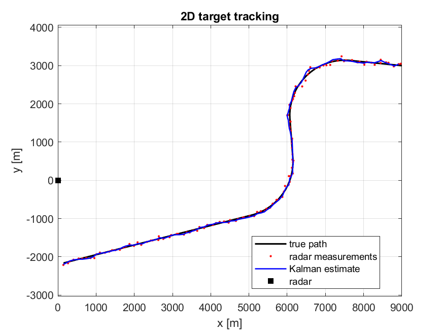
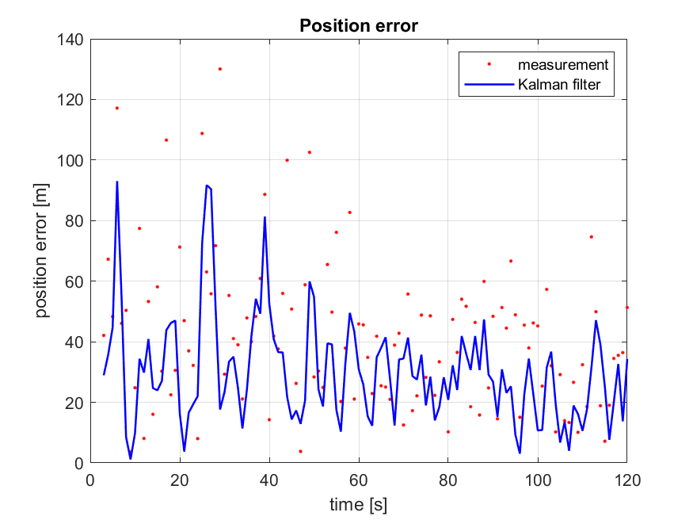
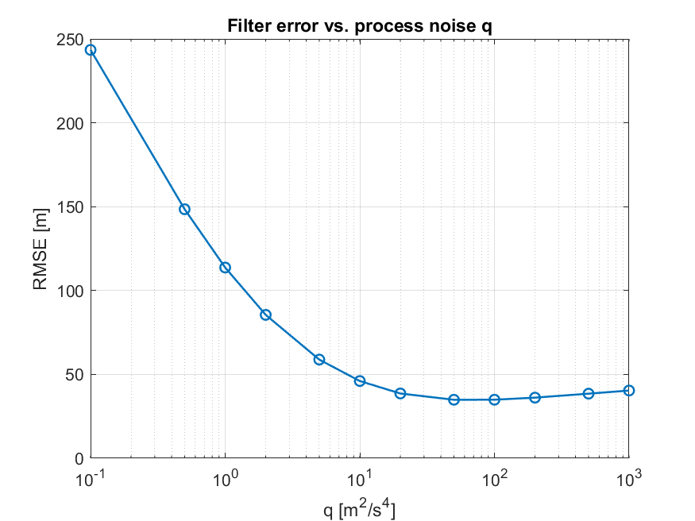

# 2D Radar Tracker with Kalman-Filter
Small MATLAB project where I track a single target in 2D with a Kalman filter. A simulated radar at the origin measures range and bearing once per second, with noise. The filter estimates position and velocity from those measurements.

I wrote it to understand how state estimation works in practice after seeing the theory in Regelungstechnik (Control Engineering).

## What it does

- simulates a target at about 100 m/s with two turns
- generates noisy radar measurements (25 m range noise, 0.4 deg bearing noise) and converts them to x/y
- runs a linear Kalman filter with a constant velocity model
- compares the position error of the raw measurements and the filter estimate (RMSE)

In my runs the filter roughly halves the position error compared to the raw measurements. During the turn the error goes up for a few seconds, because the constant velocity model does not expect a turn.

## Files

| file | content |
| `main.m` | settings, filter setup, plots |
| `simulate_target.m` | true target path |
| `radar_measurement.m` | noisy range/bearing measurement and its covariance in x/y |
| `kalman_step.m` | one predict + update step |

## How to run

Open the folder in MATLAB and run `main.m`. No toolboxes needed. The plots are saved to `results/`.

## Results

Tracking with q = 50 m²/s⁴:

   

Position error over time:

   

 Filter error for different values of q:

   

Small q makes the filter lag behind in the turns. The error drops until q ≈ 50 m²/s⁴, which matches the turn acceleration of the target (v·ω ≈ 7 m/s², squared ≈ 49). Larger q does not help further because the filter starts following the measurement noise.

## Things I want to try next
- EKF that uses range and bearing directly instead of converting to x/y
- an IMM filter (constant velocity + turn model) so the error during the turn stays low
- more than one target, which needs data association
